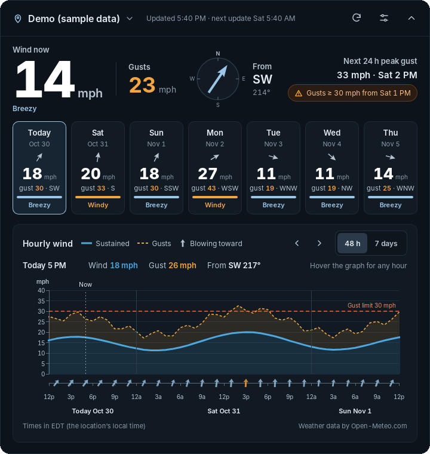

# Wind Widget

A small Windows desktop widget that shows the wind forecast for any place:
sustained wind, gusts and direction, hour by hour, for up to 16 days.



- **Big, glanceable numbers**: wind now, gusts, direction and the next 24 hours' peak gust.
- **Daily tiles**: each day's peak wind and gust, color-coded Calm / Breezy / Windy / Strong. Click one to jump the graph to that day.
- **Hourly graph**: sustained wind (solid), gusts (dashed, shaded band), direction arrows that point where the wind is blowing, your gust limit, and a "now" line. Every axis tick has a value: wind speed up the side, hours and days along the bottom. Switch between 48 hours and the full forecast, step through days with the ‹ › buttons, and hover any hour for exact numbers.
- **Compact mode** for a small corner of the desktop.
- **Any location**: search by city, ZIP or place name, keep favorites, or use your current location.
- **Updates every 12 hours** on its own, after the PC wakes from sleep, and whenever you change location. The last forecast is kept, so it still shows something offline.
- **Optional notification** when gusts will pass your limit in the next 24 hours.
- Units: mph, knots, km/h or m/s. Forecast length: 3, 7, 10 or 16 days (days past a week are shown faded because they are less reliable).

Weather data comes from [Open-Meteo](https://open-meteo.com/) (free, no API key, CC BY 4.0).

## Install

1. Go to this repository's **Releases** page and download `Wind Widget_x.y.z_x64-setup.exe`.
   (No release yet? See *Build the installer on GitHub* below.)
2. Run it. Windows SmartScreen may warn that the app is unrecognized, because the installer isn't code-signed; choose **More info → Run anyway**.
3. The widget appears in the middle of the screen and asks for a location. Drag it by its top bar to wherever you want it; it remembers the spot.

The widget has no taskbar button. Use its **tray icon** (bottom-right, near the clock) to show or hide it, refresh, open settings, or quit.

## Using it

| To… | Do this |
| --- | --- |
| Change location | Click the location name (top left) and pick a favorite, or open **Settings** and search |
| See a day in detail | Click its tile |
| See the whole forecast | Click **7 days** (or 10/16) above the graph |
| Get exact numbers | Hover the graph |
| Make it smaller | Click the ⌃ button (top right); click ⌄ to expand again |
| Change units, thresholds, opacity, startup | **Settings** (the slider icon) |

## Build it yourself

You need:

- [Node.js 22](https://nodejs.org/) or newer
- [Rust](https://www.rust-lang.org/tools/install) (stable)
- On Windows: [Microsoft C++ Build Tools](https://visualstudio.microsoft.com/visual-cpp-build-tools/) ("Desktop development with C++"). WebView2 is already part of Windows 10 and 11.

Then:

```bash
npm install
npm run tauri dev     # run the widget with live reload
npm run tauri build   # make the installer in src-tauri/target/release/bundle/
```

### Working on the UI in a browser

You don't need Rust for UI work:

```bash
npm install
npm run dev
```

Open <http://localhost:1420> for live data, or <http://localhost:1420/?demo> for built-in sample data (works offline). Desktop-only features (tray, autostart, keeping the window behind others) are skipped in the browser.

### Checks

```bash
npm test               # unit tests for the forecast logic
npm run build          # type-check and bundle
npm run render-chart   # draws the graph with sample data to chart-preview/*.svg
```

## Put it on GitHub

1. Create an empty repository on GitHub (no README or license; this project has them).
2. In this folder:

   ```bash
   git init
   git add .
   git commit -m "Wind Widget"
   git branch -M main
   git remote add origin https://github.com/<you>/wind-widget.git
   git push -u origin main
   ```

   Or with [GitHub Desktop](https://desktop.github.com/): **File → Add local repository**, choose this folder, then **Publish repository**.

### Build the installer on GitHub

Two workflows are included in `.github/workflows/`:

- **CI** runs the tests and compile checks on every push and pull request.
- **Build Windows installer** makes the `.exe` and `.msi` on a Windows machine in the cloud:
  - Run it from the **Actions** tab → *Build Windows installer* → **Run workflow**, then download the installer from the run's **Artifacts**.
  - Or push a version tag to also create a draft release with the installer attached:

    ```bash
    git tag v0.1.0
    git push origin v0.1.0
    ```

    Then open **Releases**, check the draft, and publish it. Bump `version` in `package.json` and `src-tauri/tauri.conf.json` for each new release.

## How it works

```
index.html, src/        The widget UI (TypeScript, no framework)
  main.ts               State, rendering, settings, the 12-hour refresh timer
  forecast.ts           Turns Open-Meteo data into days, levels and labels (unit-tested)
  chart.ts              The hourly graph (Apache ECharts)
  api.ts                Open-Meteo forecast and place search
  settings.ts           Settings and cached forecast (saved in the app's local storage)
  platform.ts           Desktop features, with browser fallbacks
src-tauri/              The Windows app shell (Tauri 2, Rust): window, tray icon, plugins
tests/                  Unit tests and sample data
scripts/render-chart.ts Renders the graph to SVG without a browser
```

- The forecast is requested in your chosen unit with the location's own time zone, so all times on the widget are local to the place you're looking at.
- A timer checks every 30 seconds whether 12 hours have passed, whether a failed update should be retried (after 1, 2, 5, 15, then every 30 minutes), or whether the PC just woke up.
- "Now" moves forward with the clock between updates, using the hourly forecast.

### Privacy

The only data that leaves your PC is the location you search for or choose, sent to Open-Meteo to get the forecast. There are no accounts, analytics or tracking. If you use "Use my current location", Windows asks for permission first.

### Known limitations

- **Show desktop (Win + D)** hides the widget along with other windows; it comes back when you restore your windows. The widget otherwise stays behind normal windows.
- The installer isn't code-signed, so SmartScreen warns on first install.
- Open-Meteo's free service is for non-commercial use. For commercial use, see their [pricing](https://open-meteo.com/en/pricing).

## License

MIT, see [LICENSE](LICENSE). Weather data © Open-Meteo.com, [CC BY 4.0](https://creativecommons.org/licenses/by/4.0/).
